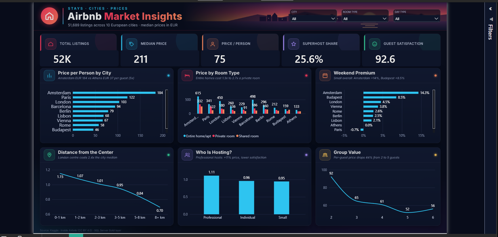
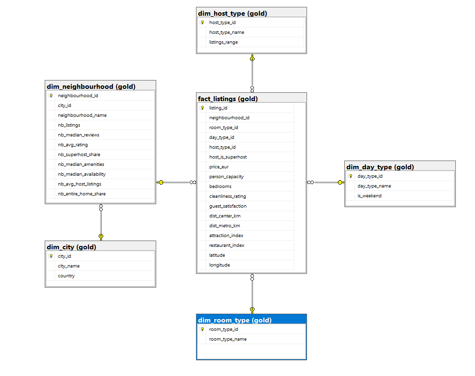

# Airbnb Prices in European Cities: End-to-End Data Pipeline & Dashboard

An end-to-end data project on **51,707 Airbnb listings across 10 European cities**: data collection, web scraping, cleaning, a **SQL Server Bronze / Silver / Gold** pipeline, exploratory analysis and an interactive **Power BI** dashboard.

> Sprint 1 project, Instant AI Data Analysis Training.



## Pipeline

```
Kaggle (20 CSV files) ──► merge ──┐
                                  ├──► Bronze (raw) ──► Silver (clean) ──► Gold (star schema) ──► Power BI
Inside Airbnb (Selenium) ─────────┘
```

| Layer | Tables | Content |
|---|---|---|
| Bronze | `kaggle_listings`, `iab_listings` | Raw data exactly as collected (51,707 + 309,154 rows) |
| Silver | `listings`, `neighbourhood_features` | Cleaned, typed and enriched data (51,689 rows, 515 neighbourhoods) |
| Gold | `fact_listings` + 5 dimensions | Normalized schema with primary and foreign keys |

### Gold data model



## Steps

| Notebook / script | What it does |
|---|---|
| `01_data_loading` | Merges the 20 city/day-type files into one master dataset |
| `02_data_quality` | Missing values, duplicates, outliers, correlation check |
| `03_scraping` | Selenium collects Inside Airbnb files (CC BY 4.0) for the 10 cities |
| `04_enrichment` | Spatial join: assigns every listing to its neighbourhood and adds neighbourhood features |
| `05_load_bronze` | Loads raw data into SQL Server with SQLAlchemy |
| `06_cleaning_silver` | Cleaning, outlier removal (>30x city median), Excel export, Silver layer |
| `07_eda` | Eight business questions answered with charts |
| `08_price_model` | Price regression (R² 0.74 log) and price-tier classification (68% / 81% accuracy) |
| `sql/gold_layer.sql` | Builds the normalized Gold schema (PK, FK, CHECK constraints) |
| `report/` | Full project report (PDF) |
| `dashboard/` | Power BI report connected to the Gold layer, DAX measures and theme |

## Key insights

1. **City drives price most:** Amsterdam costs about 5x more per person than Athens (EUR 184 vs EUR 37).
2. **Size and location set the price, not ratings:** capacity and closeness to attractions matter; guest ratings barely do.
3. **Mixing cities hides patterns (Simpson's paradox):** superhosts look cheaper overall but price the same as their city.
4. **Professional hosts charge more for less:** 11% above the city median, with lower guest satisfaction.
5. **Groups get better value:** price per person falls about 44% from 2-guest to 5-guest listings.

## Price prediction model

Models were evaluated on a test set split **by apartment** (weekday and weekend copies of the same listing never appear in both sets, avoiding data leakage).

**Regression (predict the price):**

| Model | R² (log) | Median error | Within 20% |
|---|---|---|---|
| Baseline (city + room median) | 0.51 | 24.5% | 42% |
| Ridge regression | 0.67 | 20.3% | 49% |
| Random Forest | 0.73 | 17.4% | 55% |
| **Gradient Boosting** | **0.74** | **17.6%** | **56%** |

**Classification (price tier for the city):** Budget / Mid-range / Premium accuracy **68%** (chance 33%, only 3.1% Budget-Premium confusions); above / below city median accuracy **81%**.

Top drivers: closeness to attractions, room type, city, capacity, neighbourhood superhost share, bedrooms.

## Tools

Python (pandas, NumPy, Matplotlib, GeoPandas, Selenium, SQLAlchemy, scikit-learn) · SQL Server · Power BI (DAX) · Excel

## Data sources

- [Airbnb Prices in European Cities](https://www.kaggle.com/datasets/thedevastator/airbnb-prices-in-european-cities) (Kaggle)
- [Inside Airbnb](https://insideairbnb.com/get-the-data/), licensed under CC BY 4.0. Airbnb's own terms prohibit scraping, so this licensed source was used instead.
